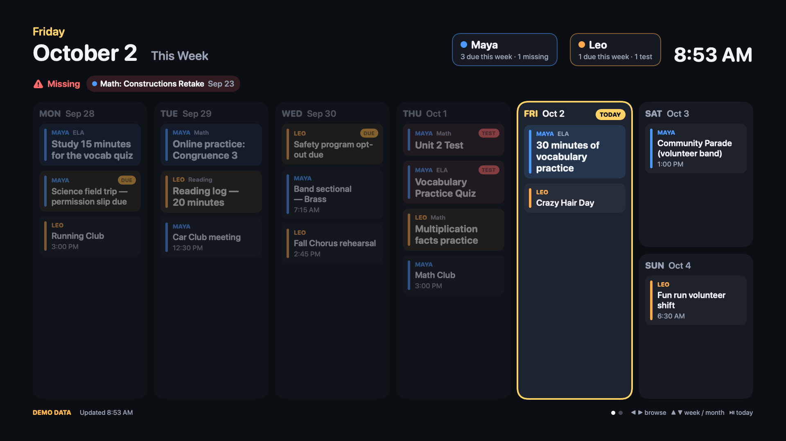

# School Board

An Apple TV wall calendar that shows the kids what's due at school this week and this month,
similar to a Skylight display.



## How it works

```
Google Classroom daily summary ─┐
ParentSquare / band emails ─────┼─► Muse ─► Google Calendar ─► secret iCal URL ─┐
                                                                                ├─► Apple TV app
Oak Middle School calendar (public iCal) ─────────────────────────────────────┘
```

* **Muse** turns school emails into calendar events. The kids' Chromebook accounts are never touched.
* **The app** downloads iCal feeds directly. tvOS has no EventKit and Google doesn't allow Calendar
  sign-in on TV, so the app reads iCal URLs instead. There's no server and no sign-in.
* Your personal calendar is filtered: only events whose titles follow Muse's conventions appear.

| Title on the calendar | Shown as |
|---|---|
| `[Maya] Math: Online practice: Congruence 3` | Homework (Maya's color) |
| `[Maya] Math TEST: Unit 2 Test` (or "test/quiz/exam" in the title) | Test (red) |
| `⚠️ MISSING [Maya] Math: Constructions Retake` | Missing (red banner across the top) |
| `[OMS] Picture Make-Up Day` / `Soccer Tryouts (OMS)` | Event for the kid who owns the tag |
| `[OMS] … permission slip due` | Deadline (amber "DUE") |
| `Dentist appointment`, `Drop kids`, … | Hidden |

School calendars (`"mode": "school"`) show only all-day events (no-school days, end of quarter,
picture day) when `allDayOnly` is set. Most school calendars are full of sports games otherwise.

## Setup

1. **Add your calendar's secret iCal URL.** In Google Calendar on the web, open Settings → *your calendar*
   (or the "Kids School" calendar if Muse writes there) → *Integrate calendar* → copy
   **Secret address in iCal format**. Paste it into `SchoolBoard/BoardConfig.json` (that file is
   gitignored; `BoardConfig.example.json` is the template). Treat this URL like a password.
2. Add each school's public calendar as a `"mode": "school"` feed (Google Calendar → the school calendar's
   settings → *Public address in iCal format*).
3. Kids, colors and tags are also in `BoardConfig.json`. The examples use the made-up kids "Maya" (tags
   `OMS`, `Band`) and "Leo" (tag `Pine`). Change them to match the tags your Muse rules use.

## Build & install on the Apple TV

```bash
brew install xcodegen        # once
export DEVELOPMENT_TEAM=XXXXXXXXXX              # your Apple team ID (Xcode → Settings → Accounts)
export BUNDLE_ID=com.yourname.schoolboard
xcodegen generate            # regenerates SchoolBoard.xcodeproj from project.yml
open SchoolBoard.xcodeproj
```

1. Xcode → Settings → Components: install the **tvOS** platform (needed for the simulator and devices).
2. Pair the Apple TV: on the TV, open Settings → Remotes and Devices → Remote App and Devices. In Xcode,
   open Window → Devices and Simulators, then pick the Apple TV.
3. Select the Apple TV as the run destination and press ⌘R.
   * With a **paid** Apple Developer account the install lasts a year. With a free account it expires after 7 days.
4. On the Apple TV, set Settings → General → **Sleep After → Never** if it should stay up.
   The app already disables the screensaver while it's open.

Launch with the `-demo` argument (Scheme → Run → Arguments) to see sample data.

## Using it

The board rotates on its own: week view (75 s), then month view (25 s). With the Siri Remote:

| Button | Action |
|---|---|
| ◀ ▶ | Previous / next week (or month) |
| ▲ ▼ | Switch between week and month |
| ⏯ | Back to today |

It returns to the current week after 3 idle minutes, refreshes feeds every 10 minutes, keeps showing the
last downloaded copy if the network drops, and dims from 9 pm to 6 am.

On Saturday and Sunday the week view looks ahead: this weekend first, then next week's school days.

## Code

| Path | What |
|---|---|
| `BoardCore/` | Swift package: iCal parser + RRULE expansion, Muse title classifier, week/month date math. Platform-independent and unit-tested. |
| `SchoolBoard/` | tvOS SwiftUI app: `BoardStore` (fetch + cache), `BoardView` (rotation, remote), `WeekView`, `MonthView`. |
| `project.yml` | XcodeGen spec. Team and bundle ID come from `DEVELOPMENT_TEAM` / `BUNDLE_ID` env vars. |

```bash
cd BoardCore && swift test
# also run the parser against a real school calendar you've downloaded:
SCHOOL_ICS=/path/to/school.ics swift test
```

## Known gaps

* No app icon / Top Shelf image yet (Xcode warns; it doesn't block a dev install).
* Homework appears only if Muse creates it from the Classroom guardian summaries, which requires being
  added as a guardian in Google Classroom for each child.
